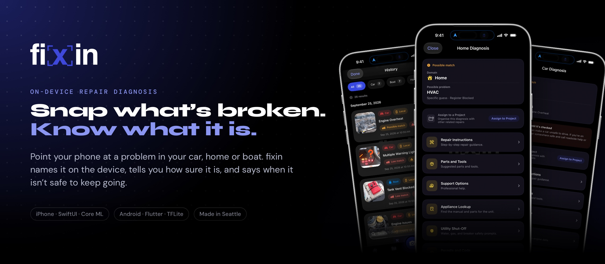
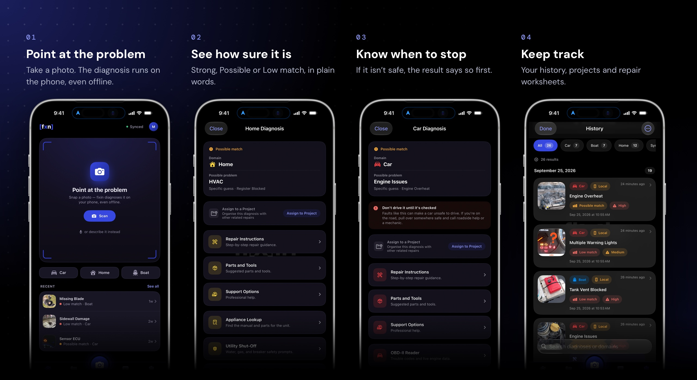
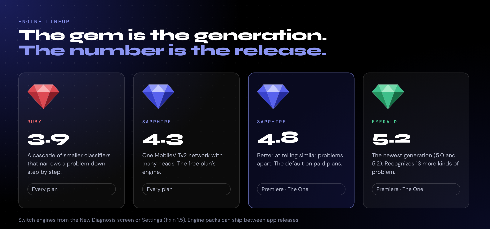

  

  
  
  
  

  <a href="https://apps.apple.com/us/app/fixin/id6755448308"><b>fixin for iPhone</b></a>
  &nbsp;·&nbsp;
  <a href="https://play.google.com/store/apps/details?id=com.fixin.android"><b>fixin for Android</b></a>
  &nbsp;·&nbsp;
  <a href="https://amsolutions-sea.com/fixin"><b>amsolutions-sea.com/fixin</b></a>

---

**fixin** is a repair app for cars, homes and boats. Point your phone at a problem and fixin tells you what you're looking at. The diagnosis runs on the phone, so it works offline. Every result says how sure it is, and leads with a warning when a problem isn't safe to keep using.

I'm Matt, and I build fixin on my own: the iPhone app, the Android app, the API, and the models and training pipeline behind them.

> [!NOTE]
> fixin's source code is private. This repo is the public overview: what fixin does, how it's built, and links to the parts that are public.

## What it does

  

1. **Point at the problem.** Take a photo, or describe what's wrong in words. fixin works out the domain (car, home or boat), the category and, on paid plans, a best guess at the specific fault.
2. **See how sure it is.** Results say *Strong*, *Possible* or *Low match* instead of showing a raw percentage. When the top answer is weak or close to the next one, fixin shows the alternatives too.
3. **Know when to stop.** If a fault can be dangerous, the result opens with a safety warning.
4. **Keep track.** History, projects and repair worksheets keep a repair together from first photo to finished job.

## Engineering highlights

- **The diagnosis runs on the phone.** Models run in Core ML on iPhone and TensorFlow Lite on Android, so a diagnosis needs no connection.
- **One network replaced 118 models.** The first engines were a cascade of 118 small classifiers. They were replaced by a single MobileViTv2 network with 117 output heads. It beat the cascade at every level of the tree and cut the per-phone download from about 330 MB to about 42 MB.
- **Confidence that means something.** Each head has its own temperature, fitted on held-out photos, so the match strength a result shows reflects how often results like it are right.
- **Engines ship between app releases.** Engine packs are listed in a catalog signed with Ed25519, with a SHA-256 for every file, so a new engine can reach phones without a store update. The public side lives in [fixin-model-updates](https://github.com/MatthewMcLellan/fixin-model-updates).
- **Two native apps, one product.** The iPhone app is Swift and SwiftUI and the Android app is Flutter. They share no code, and every feature is ported between them by hand.
- **An App Clip under 15 MB.** On iPhone, an App Clip runs the full on-device engine in 11.4 MB: one photo, no account, nothing uploaded.

More detail: [How fixin is built](docs/architecture.md) · [The ML behind the diagnosis](docs/ml.md)

## How it's built

  

## Engines

  

Each engine is named for a gem and a version: the gem marks the generation and the number is the release. Since fixin 1.5, you can switch between the engines your plan includes from the New Diagnosis screen or Settings.

## Tech stack

| | |
| --- | --- |
| **iPhone** | Swift, SwiftUI, Core ML, App Clip, CoreBluetooth |
| **Android** | Dart, Flutter, Riverpod, TensorFlow Lite |
| **ML** | PyTorch, CUDA, MobileViTv2, CLIP, coremltools, TFLite converter |
| **API** | TypeScript, Node.js, Express, PostgreSQL, Drizzle, OpenAPI |
| **Infrastructure** | AWS S3 and EC2, Netlify, GitHub Releases |

## Public repos

| Repo | What's in it |
| --- | --- |
| [fixin-releases](https://github.com/MatthewMcLellan/fixin-releases) | Android APKs, for installing outside Google Play |
| [fixin-model-updates](https://github.com/MatthewMcLellan/fixin-model-updates) | Signed catalogs for over-the-air engine updates |

## About

fixin is made in Seattle by [AM Solutions](https://amsolutions-sea.com). Before I built it I taught special education, ran a tutoring business, coached a drumline and taught skiing. I've also done a lot of my own home, car and boat repairs, and those repairs shaped the problems fixin knows.

- Website: [amsolutions-sea.com/fixin](https://amsolutions-sea.com/fixin)
- LinkedIn: [Matt McLellan](https://www.linkedin.com/in/mattmcl3llan)
- Support: [help@fixin-support.com](mailto:help@fixin-support.com)

---

© 2026 AM Solutions, Seattle, WA. All rights reserved. fixin's source code is not public. The text and images in this repository may not be reused without permission; see <a href="LICENSE">LICENSE</a>.
