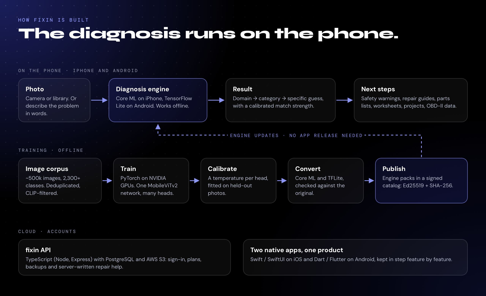

# How fixin is built

fixin has three parts: two native apps that run the diagnosis, an offline training pipeline that produces the engines, and a small cloud service for accounts.

## On the phone

A diagnosis starts with a photo, from the camera or the library. You can also describe the problem in words instead.

1. **Engine.** The photo goes to the selected diagnosis engine. It runs in Core ML on iPhone and TensorFlow Lite on Android, entirely on the device.
2. **Result.** The engine answers in three levels: the domain (car, home or boat), the category (for example HVAC or Brakes), and a best guess at the specific fault. Each answer carries a calibrated match strength: *Strong*, *Possible* or *Low*.
3. **Next steps.** If the category can be dangerous, the result leads with a safety warning. After that come repair guides in three levels of detail, parts and tools, worksheets, projects and, on Android, live OBD-II engine data from a Bluetooth reader.

Diagnosis works offline. The network is only needed for sign-in, plan changes, backups and the repair help that's written on fixin's servers.

## Two native apps, one product

The iPhone app is Swift and SwiftUI. The Android app is Dart and Flutter. They share no code, so every feature is built twice:

- A change ships on one platform first and is ported to the other by hand, matched by commit message.
- Android files say which Swift file they port, as in `// Flutter port of ModelUpdateService.swift`.
- Ports work feature by feature, not file by file. The ML runtimes, UI frameworks and platform APIs differ too much for a line-by-line copy.

Running two codebases costs more effort, but each app gets its platform's own UI conventions and ML runtime, with no cross-platform layer in between.

## Engines and how they update

An engine is a set of model files plus a manifest. Every app version bundles a free engine, so a fresh install can diagnose before it has ever connected.

Newer engines arrive as **engine packs**:

- The iOS publishing tool, written in Python, runs the same checks the app runs on device before anything is uploaded. A bad pack fails at publish time, not on someone's phone.
- Packs are versioned by content digest, so publishing the same files twice gives the same version.
- The catalog that lists the packs is signed with **Ed25519**, with a **SHA-256** for every file. The public copy is [fixin-model-updates](https://github.com/MatthewMcLellan/fixin-model-updates).
- Each plan includes certain engines. Since 1.5, you can switch between them from the New Diagnosis screen or Settings.

## Cloud

A TypeScript API (Node.js, Express, Drizzle) on PostgreSQL handles accounts, plans, backups and server-written repair help. Files live in AWS S3. The website is a static site on Netlify, with a custom prerender step that gives every page its own title and share card.

## Release discipline

Every release's store notes carry a **"do not claim"** table: each tempting line of marketing copy that the code doesn't support yet, with the reason. Store copy, the website and social posts are checked against it before they go out.
